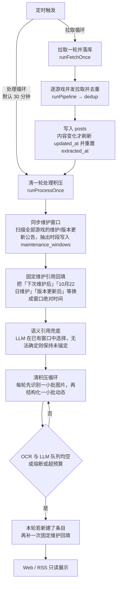
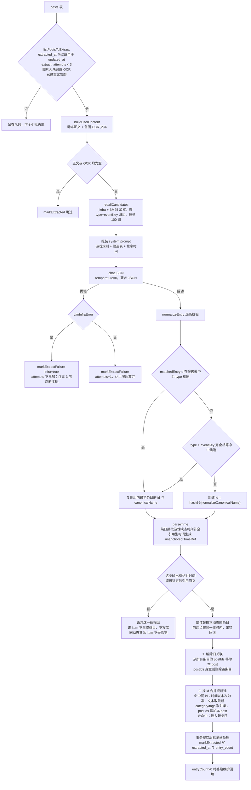
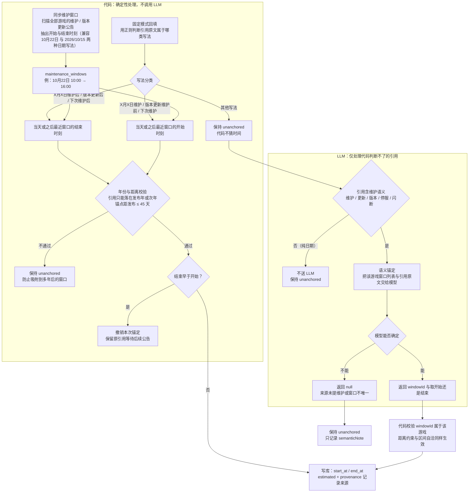

# 单条动态处理流程

本文件描述一条社媒动态从拉取入库到生成条目、回填时间的完整路径。实现入口见 [src/scheduler.ts](src/scheduler.ts)、[src/processing/extract.ts](src/processing/extract.ts)。

## 一、批次编排

两套循环共用一个 `busy` 标志，上一轮未完成时新轮次直接跳过。

## 二、单条动态主线

`normalizeEntry` 先校验 `type` 与 `slot` 是否在白名单内，非法时丢弃的是这一条 LLM 输出；随后才进去重与时间解析分支。

## 三、时间锚定

对应关系：

| 引用原文 | 处理方 | 规则 |
|---|---|---|
| `10月22日维护后`、`版本更新后`、`下次维护后` | 代码 | 取日期对应窗口的结束时刻 |
| `10月22日维护`、`版本更新维护前`、`下次维护` | 代码 | 取日期对应窗口的开始时刻 |
| `11月5日维护` | 代码（延迟） | 当前无该日期窗口，保持未锚定；公告到达后的下一轮自动回填 |
| `即将上线`、`3.7版本活动期间` 等 | LLM | 只能从已有窗口中选择；来源动态未提维护则返回 null |
| 纯日期（`10.22`、`10月15日`） | 代码 | 按游戏缺省时刻补全并标 `estimated`，不送语义锚定 |

约束：

- 引用没有年份时，只允许落在条目发布年或次年；锚点与发布时间的绝对差不超过 45 天。
- `下次维护` 系列额外要求窗口不早于发布日（允许维护当天发布）。
- 锚定后结束早于开始时，撤销本次新增的锚定，不让错误端点形成超长或倒置区间。
- 已锚定的引用不重算，只有未锚定的参与回填。

执行时机：

1. `syncMaintenanceWindows` 与 `anchorAllMaintenanceRefs` 在每轮处理链开始时先跑一次，保证本轮新提取的条目能看到已锚定的时间。
2. 本轮新建了条目时，处理链结束再跑一次 `anchorAllMaintenanceRefs`，覆盖新产出的维护引用。
3. `resolveAllSemanticRefs` 只处理固定模式判定失败且含维护语义的引用，且 `semanticCheckedAt` 早于最新公告时间才调用；无新公告不重复请求 LLM。

代码侧只做字符串模式匹配与窗口查表，不需要理解语义；LLM 只做「这句话指的是哪个已有窗口」的选择，输出仍由代码校验，模型不能凭空生成时间。

## 四、状态与写入点

| 阶段 | 触发条件 | 写入 | 跳过/失败后的状态 |
|---|---|---|---|
| 拉取入库 | 每轮拉取 | `posts` | 内容未变不刷新 `updated_at`，下游幂等 |
| OCR | 图片无记录，或 `failed` 且未达上限并过冷却 | `ocr_records` | 基础设施失败不累加 `attempts` |
| 结构化 | `extracted_at` 为空或早于 `updated_at`，且图片 OCR 已完成 | `entries`，并回写 `posts.entry_count` | 正文与 OCR 均为空时直接 `markExtracted` 并记 0；内容失败累计 3 次放弃 |
| 维护窗口 | 公告命中维护/更新关键词且含明确时段（支持 `2026/10/15` 写法） | `maintenance_windows` | 解析不到窗口则忽略 |
| 时间回填 | 条目存在未锚定引用 | `entries.start_at/end_at/payload` | 无匹配窗口或超出年份/距离约束保持 `unanchored` |
| 语义锚定 | 公告更新后、该引用未检查且含维护语义 | `payload` 的 `TimeRef` 审计字段 | 返回 null 或校验不通过只记 `semanticNote` |

## 五、边界说明

- 一条动态可以产出 0 条或多条条目；`replaceEntriesForPost` 按 post 整体替换，重跑不会留下该 post 的旧条目。
- 代码侧不做关键词预过滤：是否与排期有关由 Prompt 判定，防止词表覆盖不全导致含活动的动态被永久跳过。
- 召回只读，0 次 LLM 调用；`eventKey` 兜底只做完全相等匹配，不做子串或模糊合并。
- OCR 与 LLM 队列未清空时由处理循环继续小批处理，单轮受 `PROCESS_TIME_BUDGET_SECONDS` 约束。
